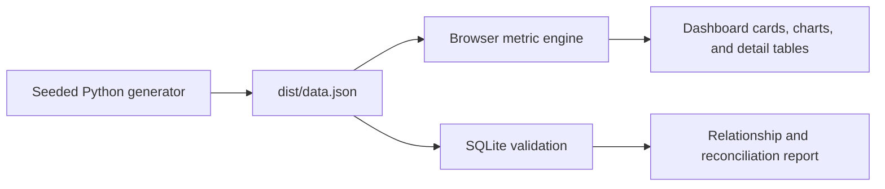

# Finance & Sales Cockpit

A browser-based portfolio demo for a fictional small business, **Northstar Operations**. Every customer, product, order, invoice, and payment is synthetic. The fixed snapshot date is 22 October 2026. No client information or real business impact is claimed.

## Run locally

Python 3.10+ is enough to generate and serve the app. Node 18+ is used only for dashboard calculation tests. No package installation is required.

```powershell
python scripts/generate_data.py
python scripts/validate_data.py
python -m http.server 8000
```

Open `http://localhost:8000/dist/`. Serve the project root so the metric definitions link resolves. The browser's `fetch` API prevents reliable use through a direct `file://` open.

## Walkthrough

1. Start with the four cards: invoiced sales, collected cash, overdue receivables, and stalled orders. Sales and cash use different dates and need not match.
2. Compare the monthly lines to see when collections lag invoicing.
3. Use the aging bars and overdue invoice list to identify follow-up priorities. The table includes each invoice's customer, due date, days late, and unpaid balance.
4. Review the stalled order queue for processing orders whose expected fulfillment dates passed.
5. Change the date range or customer to focus the entire view. Select a product to narrow the sales trend and sales rankings. Collections and invoice balances stay at customer level, as shown by the on-screen note.
6. Inspect the customer and product rankings to see how invoiced sales are distributed.

## How the data flows



See [data model](docs/data-model.md) for schemas and relationships, and [metric definitions](docs/metrics.md) for filters, time windows, and edge cases. The JSON is checked into the local repository so reviewers can run the dashboard immediately; running the generator reproduces it byte for byte.

## Verify

```powershell
python scripts/validate_data.py
python -m unittest discover -s tests -v
npm test
```

The validation script checks foreign keys, fulfilled order invoicing, payment limits, and the source invoice sum against invoiced item totals using SQLite. The tests verify deterministic generation, exception cases, dashboard totals, drill-down totals, filter behavior, and empty periods.

## Scope

This is an operating demonstration, not an ERP or accounting system. It omits taxes, credit notes, returns, partial fulfillment, and allocating invoice payments to individual product lines. The design focuses on clear decisions and traceable calculations.
