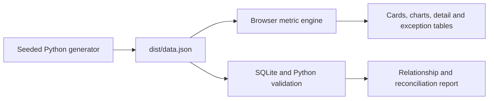

# Finance & Sales Cockpit

A browser-based portfolio demo for **Northstar Operations**, a fictional product business. Every customer, representative, product, order, invoice, payment, and adjustment is synthetic. The snapshot is fixed at 22 October 2026. No client information or real business impact is claimed.

## Run locally

Python 3.10+ generates, validates, and serves the app. Node 18+ is used for dashboard calculation tests. There are no package dependencies to install.

```powershell
python scripts/generate_data.py
python scripts/validate_data.py
python -m http.server 8000
```

Open `http://localhost:8000/dist/`. The committed `dist/data.json` lets you serve the dashboard immediately; regeneration reproduces the same snapshot. HTTP is required for the browser to fetch JSON.

## Walkthrough

1. Review net merchandise sales, net cash, overdue installments, and stalled orders. Sales exclude tax and shipping; cash subtracts refunds.
2. Compare monthly sales with collections. Review gross margin, credit notes, partial orders, and low-stock indicators below the primary cards.
3. Inspect overdue invoices. Their amounts are computed from installment schedules after credits and customer payments, so one invoice can be partly current and partly overdue.
4. Open the stalled order queue to see processing and partly fulfilled orders with remaining units.
5. Review returns and adjustments beside the inventory watch. Restockable returns add units back; non-restockable returns do not restore cost in margin.
6. Filter by dates, customer, product, region, or sales representative. Product selection limits sales, margin, credits, and stock; invoice-level cash, refunds, balances, and order status stay at the customer level.
7. Compare customer, product, representative, and region rankings. Open the in-app metric definitions for the rules used by each view.

## How the data flows



See [expansion scope](docs/expansion-scope.md), [data model](docs/data-model.md), and [metric definitions](docs/metrics.md) for the detailed assumptions. All values use integer cents. The illustrative tax rate is not jurisdictional advice.

## Verify

```powershell
python scripts/validate_data.py
python -m unittest discover -s tests -v
npm test
```

Validation checks source relationships, order fulfillment, invoices against lines and installments, line-level payment allocations, credits, refunds, and inventory. Dashboard tests check sales, margin, cash, receivables, installment aging, filters, and empty states.

## Scope and limits

The app is a transparent operating demonstration, not an ERP or accounting system. It uses one invoice for the fulfilled portion of an order, flat illustrative tax, opening stock without purchasing or replenishment, and no shipping cost, overhead, or general ledger. Cash collection is reported at invoice level even though payment allocations provide line-level traceability. The fixed synthetic data should never be presented as measured business impact.
