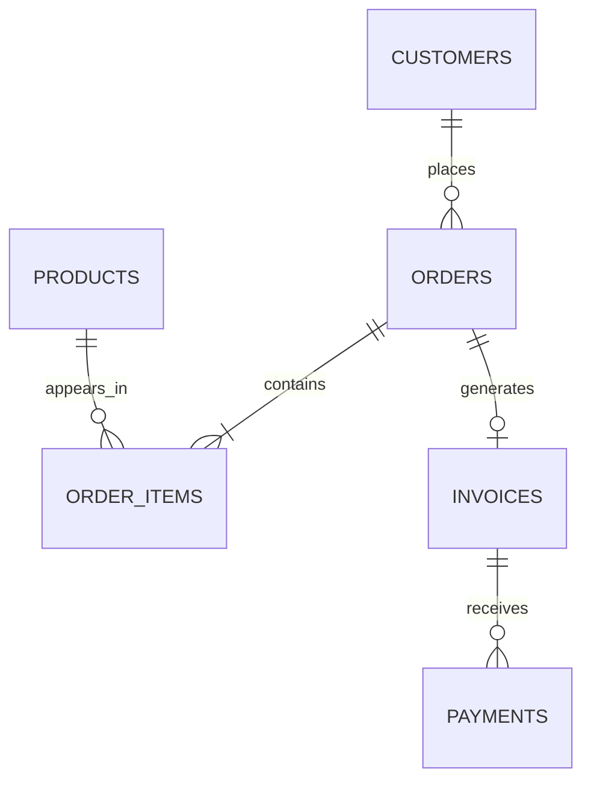

# Synthetic data model

`python scripts/generate_data.py` writes a deterministic snapshot to `dist/data.json` using seed 1427. All names and transactions are fictional. Regenerating with the same source produces identical JSON.

- `customers`: `id` primary key, `name`, `segment`, `city`, `payment_terms_days`.
- `products`: `id` primary key, `name`, `category`, `unit_price_cents`, `unit_cost_cents`.
- `orders`: `id` primary key, `customer_id` foreign key, `order_date`, `status` (`fulfilled`, `processing`, `cancelled`), `expected_fulfillment_date`.
- `order_items`: `order_id` and `product_id` foreign keys, `quantity`, `unit_price_cents`, `discount_percent`, `line_total_cents`.
- `invoices`: `id` primary key, `order_id` unique foreign key, `issue_date`, `due_date`, `amount_cents`.
- `payments`: `id` primary key, `invoice_id` foreign key, `payment_date`, `amount_cents`, `method`.

Money uses integer cents to avoid floating point errors in totals. Every fulfilled order has one invoice; processing and cancelled orders have none. Some invoices have no payments, some are partly paid, and some are paid after the due date. Several processing orders are past their expected date. This is a deliberately small demonstration model; it does not represent tax, credit notes, returns, or invoice line allocation of cash.
