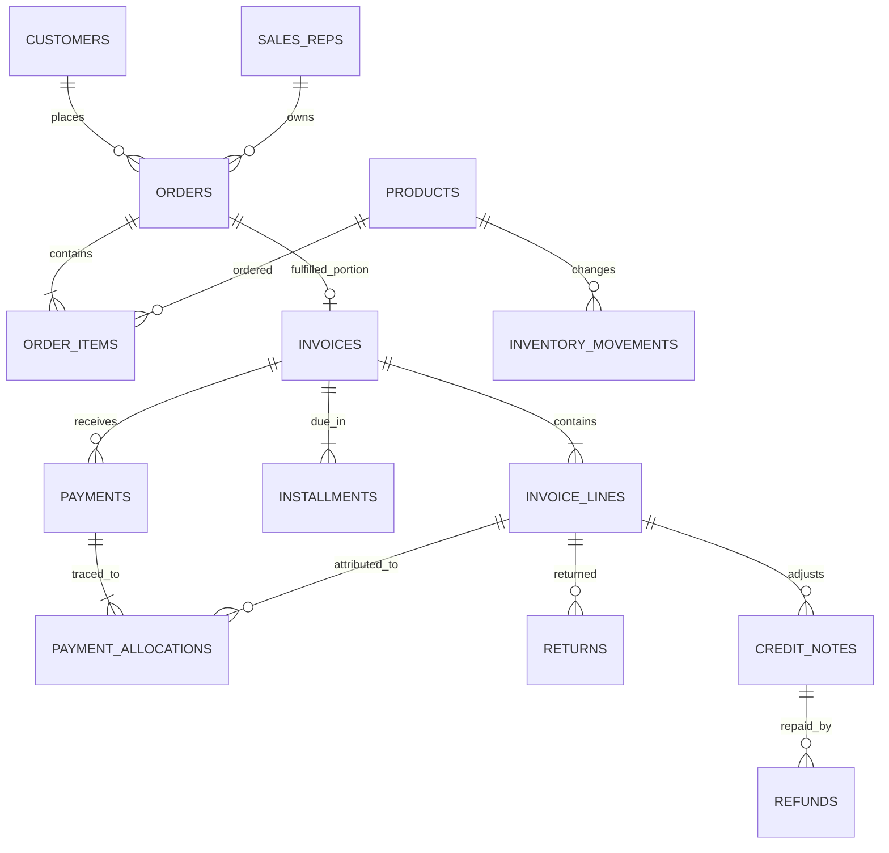

# Synthetic data model

`python scripts/generate_data.py` writes `dist/data.json` with seed 1427. The snapshot is fixed at 2026-10-22. All names and transactions are invented; running the generator with the same source reproduces the tracked JSON exactly.

| Entity | Key fields and purpose |
| --- | --- |
| `customers` | `id`, name, segment, city, region, payment terms. |
| `sales_reps` | `id`, name; owned orders inherit a representative. |
| `products` | `id`, category, price and unit cost in cents, opening units, reorder point. |
| `orders` | `id`, customer and rep IDs, dates, status, nullable cancellation reason. |
| `order_items` | `id`, order and product IDs, ordered and fulfilled quantities, unit price, discount, ordered line total. |
| `invoices` | `id`, order ID, issue/due dates, merchandise, tax, shipping, gross amount. One per order with fulfilled units. |
| `invoice_lines` | `id`, invoice and order-item IDs, fulfilled quantity, merchandise, tax, shipping allocation, product cost, gross line amount. |
| `installments` | `id`, invoice ID, due date, amount. One or two per invoice. |
| `payments` | `id`, invoice ID, date, amount, method. Some invoices have no payment or partial payment. |
| `payment_allocations` | Payment and invoice-line IDs, allocated amount. Allocations sum exactly to each payment. |
| `returns` | `id`, invoice-line ID, date, quantity, reason, restockable flag. |
| `credit_notes` | `id`, invoice/line IDs, optional return ID, type, component amounts, date. |
| `refunds` | `id`, invoice and credit-note IDs, date, amount paid back. |
| `inventory_movements` | `id`, product ID, order or return ID, date, signed unit change, reason. |

Money uses integer cents. An invoice equals the sum of its invoice lines and installments. Each invoice line equals merchandise plus tax plus its shipping allocation. Credits never exceed gross invoice value. Payments less refunds never exceed invoice value less credits. The validation script enforces those equalities, foreign keys, payment allocation totals, fulfilled quantities, and nonnegative final stock.

This model illustrates a connected business workflow; it is not a full accounting or inventory ledger. Tax is a flat illustrative rate, shipping cost and overhead are absent, inventory has opening stock rather than purchase receipts, and fulfillment generates one invoice for the fulfilled portion rather than a series of invoices.
